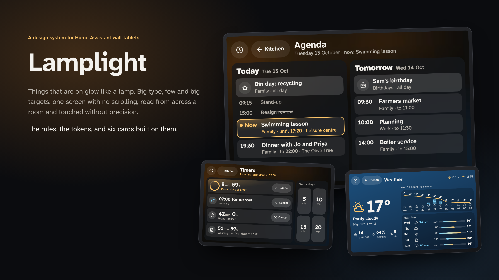
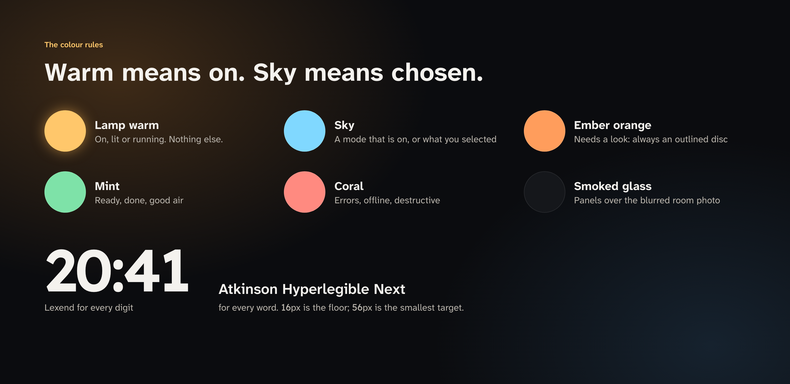
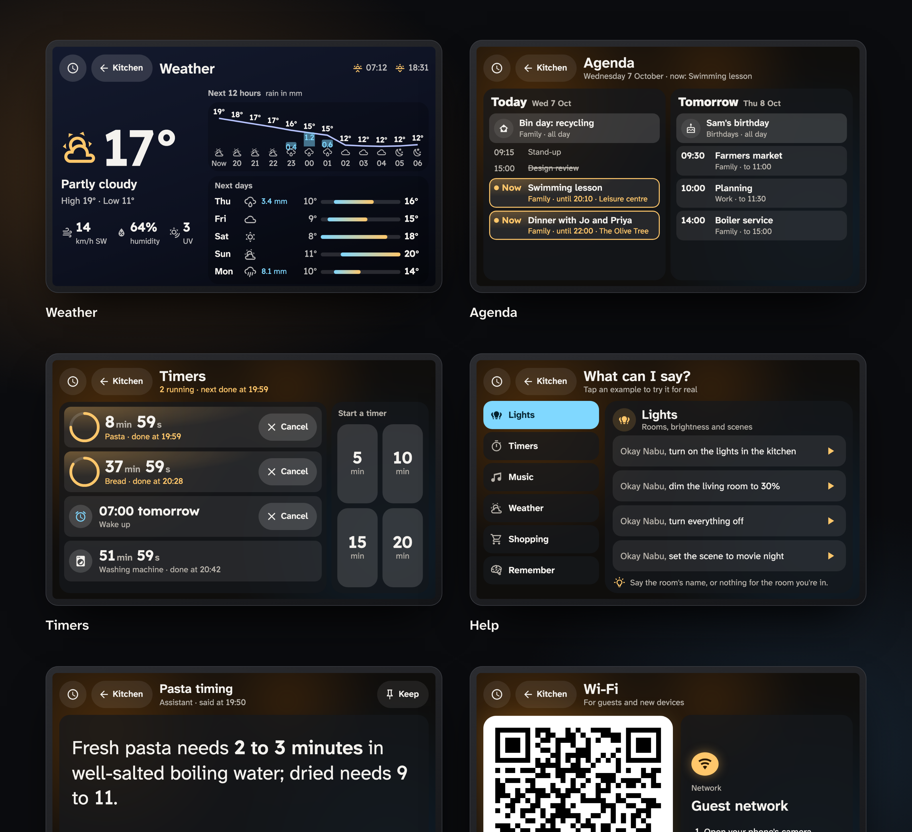

<p align="center">
  
</p>

# Lamplight

A design system for Home Assistant wall tablets, and six cards built on it.

Lamplight is written for screens that are read from across a room and tapped without looking closely: kitchen and
bedroom tablets, often running [View Assist](https://dinki.github.io/View-Assist/). Things that are on glow like a lamp.
Type is big, targets are few and large, and every page fits one screen with no scrolling.

**[Try the demo →](https://haydengriffin.github.io/lamplight/)** All six cards run on a made-up home there, with a
stand-in Home Assistant.

## The design system

[`DESIGN.md`](DESIGN.md) is the full system: the tokens, type scale, layout, components and the rules behind them. A few
of them:

- **The Lamp Rule.** Warm means on, lit or running, and nothing else. A filled, glowing disc always means on.
- **The Sky Rule.** Sky blue marks a mode that is on, or what you selected. It never decorates.
- **The Outlined Warning Rule.** A warning is an outlined orange disc, never a filled one, because filled means on.
- **The 16px Floor and the Control Floor.** No text under 16px; no touch target under 56px; primary actions 64px.
- **The One Screen Rule.** If a tablet page doesn't fit 788×492, cut content or move it into a sheet. Never shrink it.
- **The Lexend Digits Rule.** Every digit is Lexend. Atkinson Hyperlegible's slashed zero reads as "Ø" from across a room.



## The cards



| Card | What it shows |
| --- | --- |
| `lamplight-weather-card` | Now, the next 12 hours as a temperature line with rain bars, and five days of low–high bars. The page's sky follows the weather. |
| `lamplight-agenda-card` | Today and tomorrow from your calendars. What's on now glows, earlier events fade, cancelled ones are struck through. |
| `lamplight-timers-card` | View Assist timers with live countdown rings, alarms, appliance timers, and quick-start buttons. |
| `lamplight-help-card` | "What can I say?" A voice cheat-sheet where tapping an example runs it through your assistant and shows the reply. |
| `lamplight-info-card` | The assistant's last answer, auto-fitted as large as it will go, for View Assist's info pages. |
| `lamplight-wifi-card` | A guest Wi-Fi QR code big enough to scan from the sofa. The password lives only in the image. |

## Install

**HACS:** add `https://github.com/HaydenGriffin/lamplight` as a custom repository (category *Dashboard*), install
**Lamplight**, and reload the browser.

**Manually:** copy everything in `dist/` to `<config>/www/lamplight/` and add `/local/lamplight/lamplight.js` as a
dashboard resource of type *JavaScript module*.

The cards fill the screen, so give each one its own view in panel mode (or a View Assist view).

## Configuration

Every card takes these optional keys:

```yaml
nav:
  home: /dashboard-tablet/clock    # the round clock button; hidden without one
  back: /dashboard-tablet/home     # the back pill; without it, Back goes back in history
  back_label: Home
view_assist_sensor: sensor.viewassist_kitchen   # tablets running View Assist find their own
locale: en-GB                      # date and time format; defaults to Home Assistant's language
```

On a View Assist tablet the clock button goes to the device's home screen and navigation goes through View Assist.

### Weather

```yaml
type: custom:lamplight-weather-card
entity: weather.home
```

### Agenda

```yaml
type: custom:lamplight-agenda-card
calendars:
  calendar.family: { name: Family, icon: mdi:home-heart }
  calendar.work: { name: Work, icon: mdi:briefcase-outline }
```

### Timers

```yaml
type: custom:lamplight-timers-card
quick_minutes: [5, 10, 15, 20]
appliance_timers:
  - { entity: timer.washing_machine, name: Washing machine, icon: mdi:washing-machine }
```

Timers come from the tablet's View Assist sensor and are set and cancelled through View Assist. Paused timers show the
time they have left. Cancelling a running timer offers Undo for 8 seconds, which sets it again for the time it had left;
alarms, reminders and paused timers ask for a second tap instead. An appliance timer is any `timer` entity with a
`finishes_at` attribute while it runs.

### Help

```yaml
type: custom:lamplight-help-card
agent_id: conversation.home_assistant
wake_phrase: Okay Nabu
rooms: { sensor.viewassist_kitchen: kitchen }   # fills {room} in examples
categories:
  - name: Lights
    icon: mdi:lightbulb-group
    hint: Rooms, brightness and scenes
    tip: Say the room's name, or nothing for the room you're in.
    examples:
      - say: turn on the lights in the {room}
      - say: turn everything off
        confirm: true          # asks for a second tap
      - say: remember that…
        tap: false             # shown, not run
```

`run` sends different text from what's shown, `agent` sends one example to another agent, and `note` adds a small line.

To stop taps running anything while you have visitors, point `read_only_entity` at an on/off entity. While it's on, the
examples still show (as "Start with *wake phrase*, then say it") but tapping one does nothing:

```yaml
read_only_entity: input_boolean.guest_mode
```

### Info

```yaml
type: custom:lamplight-info-card
show_image: true          # for View Assist's infopic view
wake_phrase: Okay Nabu    # optional: named in "Didn't catch that"
```

A short reply that isn't an answer ("Sorry, I couldn't understand that", the greeting after a bare wake word) shows as
"Didn't catch that", with what it replied underneath. `?pic=1` in the page's address shows the image without
`show_image`, and `?alert=1` shows View Assist's `alert_data` (its header, then `line1` and `line2`), so one info view
can stand in for View Assist's `infopic` and `alert` views.

### Wi-Fi

```yaml
type: custom:lamplight-wifi-card
qr: /local/guest/wifi.svg
ssid: Guest network
```

Make the QR image from `WIFI:T:WPA;S:<network>;P:<password>;;` with any QR generator.

### Theming

The cards read their surfaces from `--l-page`, `--l-panel` and `--l-photo` (a background image shown blurred behind the
panels), so a theme or a parent card can set them. `--l-photo-show: 0` gives the solid variant.

When `--l-photo` is one image from your Home Assistant (or a site that sends CORS headers), each card blurs it once into
a small image and shows that, so the tablet doesn't run a live blur over the whole page. Gradients and other images keep
the live blur. Cards set `--l-photo-soft` and `--l-photo-filter` on themselves for this; you don't need to.

### The theme

[`themes/lamplight.yaml`](themes/lamplight.yaml) puts Home Assistant's own header, sidebar and stock cards in the
Lamplight colours, so the rest of a dashboard matches the cards. The cards don't need it. Copy it to
`<config>/themes/`, make sure `configuration.yaml` loads that folder:

```yaml
frontend:
  themes: !include_dir_merge_named themes
```

then run *Home Assistant Core: Reload themes* (or restart) and pick **Lamplight** in your profile or as a dashboard
view's theme. A theme can also set the cards' surfaces, for example `l-photo: 'url("/local/photos/kitchen.jpg")'`.

## Building on Lamplight

`src/` is plain ES modules, and `dist/lamplight.js` is an ES module with the same exports, so your own cards can share
the design system instead of copying it.

```js
import { LamplightCard, define, esc } from '/hacsfiles/lamplight/lamplight.js';  // or src/core.js in your own bundle

class PantryCard extends LamplightCard {
  defaults() { return { entity: 'sensor.pantry' }; }
  build() {
    this.built = true;
    this.shell('Pantry', '<main class="list"></main>', { sub: 'What we have' });
  }
  update() {
    const items = this.st(this.config.entity)?.attributes?.items || [];
    this.shadowRoot.querySelector('.list').innerHTML = items.map((i) => `<p>${esc(i)}</p>`).join('');
  }
  styles() { return '.list{flex:1;overflow:auto;background:var(--panel);border-radius:var(--r-tile);padding:16px}'; }
}
define('pantry-card', PantryCard, 'Pantry', 'What we have in.');
```

| Export | What it is |
| --- | --- |
| `LamplightCard` | The base class: `setConfig` (merged over `defaults()`), `hass`, `shell(title, mainHtml, {sub, extra})` (header with clock and Back, the card's main, a toast), `build()` / `update()` / `styles()` / `act(name, el)` to override, `st(id)`, `call(domain, service, data, doneText)`, `toast(text, error)`, `setSub(text)`, `hhmm(date)`, navigation (`goHome`, `goBack`, `window.lamplightNav`, `nav` config). |
| `define(tag, cls, name, description)` | Registers the element once (a second load is a no-op) and lists it in the card picker once. Returns the class registered under `tag`. |
| `TOKENS`, `BASE_CSS` | The CSS custom properties (The One Token Rule, DESIGN.md) and the shared page, header, button and toast styles that `shell()` puts in each card's shadow root. |
| `esc(value)`, `cap(text)`, `dayStart(date)` | HTML escaping for anything you interpolate, capitalising, and local midnight of a date. |
| `registerFonts(base?)`, `fontBase()` | The Lamplight Text and Lexend faces, registered on the document once when the core loads. |
| `VERSION` | This release. |
| `LamplightWeatherCard` … `LamplightWifiCard` | The six cards' classes (each registers itself when its module loads). |

Import `src/core.js` for the core alone (no cards registered), or `src/cards/<name>.js` for one card.

**Fonts.** The core looks for `ahn-latin.woff2`, `ahn-latin-ext.woff2` and `lexend-latin.woff2` next to the file it runs
from (`dist/` for the HACS bundle). If your bundle puts them somewhere else, set `window.lamplightFontBase` (ending in
`/`) before it loads, for example `'/local/fonts/'`.

## Development

Edit `src/`, then `npm ci` (once: esbuild, pinned) and `node scripts/build.mjs` to rebuild `dist/lamplight.js`; CI checks
the committed bundle is up to date. `npm test` runs the module tests (node, no browser). For the demo, serve the repo root
(`python3 -m http.server`) and open `/demo/`; `npm run demo-icons` regenerates its icon set after you add an icon.
`tools/showcase.cjs` renders the images above.

## Licence

[MIT](LICENSE). The bundled fonts are SIL OFL 1.1; see [NOTICE](NOTICE).
